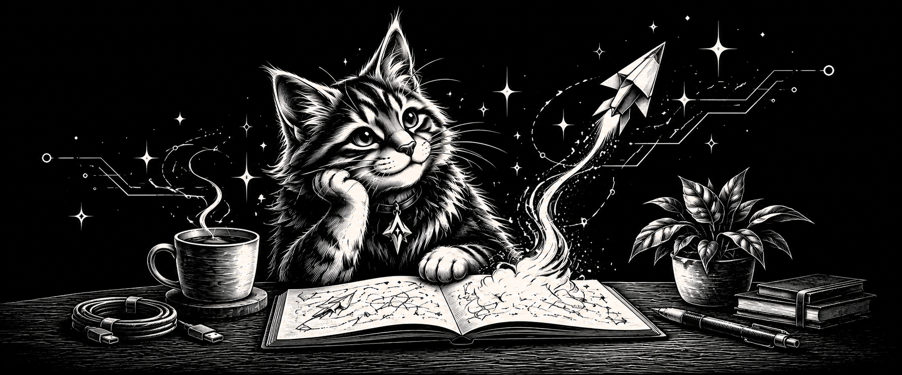

# Hello from Arevian.

  

We're a digital studio bringing design, engineering, and AI together. We make websites, applications, and tools that help people get things done — with room for a little delight along the way.

## Got an idea? Pull up a chair.

You don't need a perfect brief. A sketch, a stubborn problem, or a “wouldn't it be nice if…” is a good place to start.

Maybe you need a website, want to build an app, or have a repetitive task you'd love to hand over to a useful AI assistant. Tell us what you're thinking. We'll help you work out a practical next step.

- **Say hello on Telegram:** [@ArevianStudio](https://t.me/ArevianStudio)
- **Tell us about your project:** [hello@arevian.studio](mailto:hello@arevian.studio)
- **Explore the studio and our work:** [arevian.studio](https://arevian.studio/)

The cat has already opened a fresh notebook.

---

This repository is home to our GitHub organization profile and artwork. For the studio story and a peek at what's coming, [visit our organization profile](https://github.com/ArevianTechnologies).
