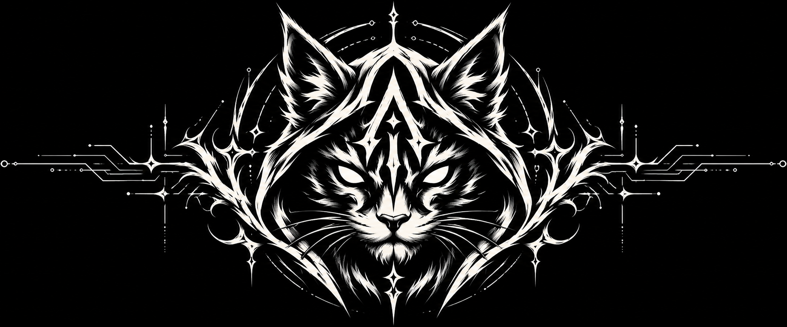
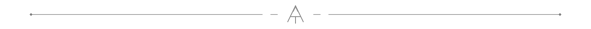

  

# We still believe in people.

Arevian is a digital studio for people with something they want to bring into the world. We bring design, engineering, and AI together to make websites, applications, and useful systems.

Good technology should give people something back: time, understanding, independence, or the courage to begin.

[Explore our work](https://arevian.studio/) · [Talk to us on Telegram](https://t.me/ArevianStudio)

## Fifteen years, and a reason to begin again

We bring fifteen years of experience to the work. There have been long nights, difficult lessons, and projects that took everything we had. We know what it feels like to work to exhaustion because you care about what you are making.

Those years taught us to recognise quality, take responsibility, and keep asking better questions. They also taught us how much creativity depends on having something left to give.

We still want to make beautiful things. We want the way we make them to feel human, too.

## We believe in vibe coding

There is something worth protecting in the moment an idea first comes alive.

For us, vibe coding means putting that idea into motion: talking it through, making a first version, seeing what it does, and following a better possibility when it appears. AI makes this conversation faster, more open, and more playful.

Experience gives that freedom a direction. We look beneath the first convincing result, understand the system, question the details, and care about what happens when a real person uses it.

We follow the spark, then do the careful work that makes a product worth trusting.

## Technology can help make peace

We believe technology can bring people closer to a more peaceful world: by opening access to knowledge, easing everyday burdens, and helping us understand one another.

That possibility depends on what we put into it.

For us, love means attention, patience, and responsibility. It means listening before building and remembering that someone has to live with the choices we make.

Faith in humanity means believing people deserve tools built with generosity and respect. It means keeping people at the centre, even as the machines become more capable.

We want the future we help build to carry that care. Every project gives us somewhere to put this belief into practice.

## What we bring to your idea

**Design** — Brand identities, websites, and interfaces that give an idea a clear character and make it easier to understand.

**Engineering** — Websites, applications, and connected systems shaped around the people and operations behind them.

**AI** — Assistants, automation, and analytics that help people spend less time on repetitive work.

Bring us a rough idea, a product that needs care, or a problem you have been carrying for a while. Let's find a useful first step together.

  

## Contact

- **Telegram:** [@ArevianStudio](https://t.me/ArevianStudio)
- **Projects & collaboration:** [hello@arevian.studio](mailto:hello@arevian.studio)
- **Government & security:** [security@arevian.studio](mailto:security@arevian.studio)
- **Studio & work:** [arevian.studio](https://arevian.studio/)

A rough idea is enough to start a conversation.
